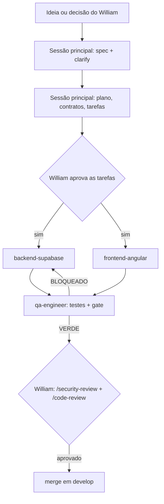

# Esteira de Desenvolvimento do Faro

Como uma feature vai da ideia ao merge, quem faz cada parte e onde estão os portões. Vale a partir
do pivô de novembro de 2026 (constituição v2.1.0).

## Quem faz o quê

| Etapa | Quem | Modelo | Saída |
|---|---|---|---|
| Spec, clarify, plano, contratos, tarefas | sessão principal do Claude Code, com o William | modelo forte (Opus/Fable) | `specs/NNN-nome/` completo |
| Design de telas | Claude Design (canvas *Faro · Telas do MVP* e *Faro Design System*) | — | telas aprovadas, exportadas para `design/telas-v2/` |
| Backend | subagente `backend-supabase` | **Sonnet** | migrations, RLS, RPCs, Edge Functions, pgTAP |
| Frontend | subagente `frontend-angular` | **Sonnet** | telas em ZardUI + Tailwind, três larguras |
| Testes e gate de segurança | subagente `qa-engineer` | **Sonnet** | testes e veredito VERDE ou BLOQUEADO |
| Crítica visual | skill `impeccable` | — | achados sobre a tela renderizada |
| Revisão final | William, com `/security-review` e `/code-review` | — | aprovação do merge |

Os subagentes `product-owner`, `tech-lead-planner` e `ui-ux-designer` foram aposentados em
2026-11-21: spec e plano são escritos na sessão principal, e o design nasce no Claude Design.

## Fluxo



1. **Spec** (`spec.md`): o quê e por quê, sem stack. Decisões já tomadas vão em "Clarifications".
2. **Plano** (`plan.md`, `research.md`, `data-model.md`, `contracts/`): a stack entra aqui. O
   Constitution Check percorre os oito princípios.
3. **Tarefas** (`tasks.md`): escritas para um agente menor executar sem contexto. Cada tarefa tem
   os arquivos exatos, a referência a seguir e um **"Feito quando"** verificável.
4. **Portão 1**: a implementação só começa com a aprovação do William.
5. **Implementação**: backend e frontend em paralelo depois que os contratos existem. Uma tarefa
   por vez, na ordem. Diante de ambiguidade, o agente para e relata.
6. **QA**: o gate de `contracts/rls-expectations.md` bloqueia o merge.
7. **Portão 2**: `/security-review` e `/code-review` quando o diff toca dados pessoais, RLS, PIN,
   página pública ou o código da tag.
8. **Merge** em `develop`, depois promoção para `homolog` e `master` (ver `git-workflow.md`).

## Como pedir a execução

Na sessão principal, depois de aprovar as tarefas:

```text
Execute a fase 1 e a fase 2 de specs/002-ui-zardui/tasks.md com o agente frontend-angular.
Pare no primeiro checkpoint e me mostre o resultado.
```

Ou, pela ferramenta Agent, `subagent_type: backend-supabase | frontend-angular | qa-engineer`,
dizendo a spec e a fase. Depois de criar ou editar agentes, reinicie a sessão (ou use `/agents`).

## Testes de banco sem Docker

A máquina de desenvolvimento não tem Docker nem a CLI do Supabase. Os testes de banco (pgTAP) e
das Edge Functions rodam no **GitHub Actions** (`.github/workflows/ci.yml`, job "supabase"): o
agente faz push da branch da feature e lê o resultado com `gh run watch`. Uma tarefa de banco só é
marcada como feita com esse job verde.

## Ordem das specs do MVP

1. `002-ui-zardui` — base visual. Começa pela verificação de compatibilidade do ZardUI com o Angular 21.
2. `004-conta-tutor` — cadastro, confirmação do celular, recuperação de senha, conta.
3. `003-tag-qr` — a tag: página pública, ativação, app do tutor, scans, admin.

`003` usa as cascas de `002` e o celular confirmado de `004`. O backend de `003` (fases 1 e 2) pode
começar em paralelo com `002`, porque não depende de UI.

## Regras de precedência

**Constituição > `docs/decisoes-pivo.md` > `CLAUDE.md` > `DESIGN.md` e specs > padrões de skills.**
A skill `angular-primeng-standard` não se aplica ao Faro. Onde a skill `angular-developer` citar
Cypress, usa-se Playwright.

## Referências

- Decisões: [decisoes-pivo.md](decisoes-pivo.md). Fluxo Git: [git-workflow.md](git-workflow.md).
- Tema e componentes: [zardui-faro.md](zardui-faro.md) e `DESIGN.md`.
- MCP do Supabase: o `backend-supabase` usa o servidor `supabase` de `.mcp.json`; aprove o servidor
  uma vez na sessão.
