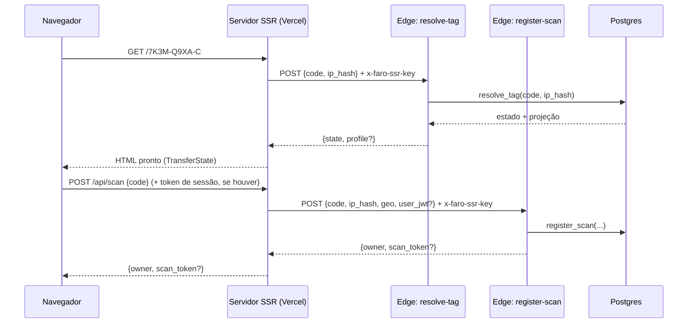

# Contrato: página pública da tag

Caminho: `/:code` (SSR). Nenhuma chamada direta do navegador ao Supabase nesta rota.



## Edge Function `resolve-tag`

- **Autorização**: cabeçalho `x-faro-ssr-key` igual a `FARO_SSR_KEY`. Sem ele: `401`, corpo vazio.
- **Entrada**: `{ "code": string, "ip_hash": string }`.
- **Passos**: `normalize` → `isValid` (falso: responde `not_found` **sem tocar o banco**) → limite
  por `ip_hash` (30 por minuto, 300 por hora; estouro: `rate_limited`) → RPC `resolve_tag` → se
  houver foto, gera URL assinada de 3600 s.
- **Saída** (`200` sempre que autorizado):

```jsonc
{ "state": "assigned", "profile": {
    "code": "7K3M-Q9XA-C",
    "pet": { "name": "Paçoca", "photo_url": "https://…assinada…" },
    "temperament": ["Dócil com pessoas", "Medo de barulho"],   // ausente se desligado
    "care_notes": "Toma remédio para alergia…",                  // ausente se desligado
    "tutor_first_name": "Ana",                                   // ausente se desligado
    "whatsapp_url": "https://wa.me/55119…?text=…",               // ausente se desligado
    "phone_display": "(11) 98765-4421",                          // ausente se desligado
    "lost": { "since": "2026-11-19T12:00:00Z", "reward": true, "message": "Ele se assusta…" } // ausente se o modo perdido está desligado; cada campo ausente se desligado
} }
{ "state": "available", "code": "7K3M-Q9XA-C" }
{ "state": "not_found" }
{ "state": "rate_limited" }
```

- **Regras**:
  - `not_found` cobre inexistente, bloqueado e anulado. As três respostas são idênticas em corpo e
    cabeçalhos; a função iguala o tempo de resposta com um piso de 150 ms.
  - Campo desligado **não aparece** no JSON (não vem `null`).
  - `whatsapp_url` é montada no servidor: `https://wa.me/<DDI+número>?text=<mensagem codificada>`,
    mensagem "Oi! Encontrei o [nome] pela tag do Faro." O número não aparece em nenhum outro campo
    quando `show_phone` está desligado.
  - Nada sobre cobrança é consultado.
  - Nenhum identificador interno (ids de pet, tutor, vínculo) é devolvido.

## RPC `resolve_tag(p_code char(9), p_ip_hash text) returns jsonb`

`security definer`, `search_path` fixo, `EXECUTE` só para `service_role`. Lê `tag_codes`, o vínculo
ativo, `pets`, `rescue_profiles` e o primeiro nome e celular em `perfis`. Devolve o estado e a
projeção sem URL de foto (devolve `photo_path` para a função assinar). Grava o contador de limite.

## Rota do servidor `POST /api/scan`

- Mesma origem; corpo `{ "code": string }`; cabeçalho `Authorization: Bearer <jwt>` opcional.
- O servidor calcula `ip_hash = HMAC-SHA256(IP_HASH_SECRET, ip)`, lê os cabeçalhos de geolocalização
  da Vercel e chama `register-scan`.
- **Resposta**: `{ "owner": boolean, "scan_token"?: string }`. Sempre `200`; em falha, `{ "owner": false }`.
- Recusa requisições sem `Origin`/`Sec-Fetch-Site` de mesma origem.

## Edge Function `register-scan`

- **Autorização**: `x-faro-ssr-key`.
- **Entrada**: `{ code, ip_hash, geo?: { lat, lng, city, region }, user_jwt? }`.
- **Regras**:
  - Se `user_jwt` for do tutor do vínculo ativo: não grava nada; responde `{ owner: true }`.
  - Deduplica: mesmo `tag_code` + `ip_hash` com `last_seen_at` nos últimos 10 minutos → atualiza
    `last_seen_at`, não envia e-mail, devolve o `scan_token` de novo só se ainda não houver
    localização precisa.
  - Senão, insere `scan_events` com `status_at_scan`, `assignment_id` (se houver), `geo_method`
    `ip` (com `accuracy_m` 3000) ou `none`, e um `scan_token` aleatório (guarda só o hash, vale 30 min).
  - Tag vinculada e não bloqueada: envia o e-mail de aviso ao tutor e grava `notified_at`.
  - Tag disponível, bloqueada ou anulada: grava o scan para a fila do admin, sem e-mail.
  - Código inválido ou inexistente: não grava; responde `{ owner: false }`.
- **Modo reenvio** (chamado pelo `pg_cron` com a chave): reenvia avisos com `notified_at` nulo das
  últimas 24 h, até 3 tentativas.

## Rota do servidor `POST /api/scan/location` → `register-scan` (ação `location`)

- Corpo: `{ scan_token, lat, lng, accuracy_m }`. Só após consentimento do navegador.
- Atualiza o scan do token para `geo_method = 'gps'`, grava coordenadas e margem, invalida o token
  e envia ao tutor o aviso "quem achou enviou a localização". Token inválido ou vencido: `200` sem efeito.

## Página: o que cada estado mostra

| `state` | Tela | Referência |
|---|---|---|
| `assigned`, sem `lost` | Resgate | `design/telas-v2/V2-resgate*.dc.html` |
| `assigned`, com `lost` | Resgate em modo perdido | `V2-resgate-perdido*.dc.html` |
| `assigned` e `owner: true` | Visão do dono | `V2-resgate-visao-dono*.dc.html` |
| `available` | Tag não ativada | `V2-tag-nao-ativada*.dc.html` |
| `not_found` | Tag não encontrada | `V2-tag-nao-encontrada*.dc.html` |
| `rate_limited`, erro ou tempo esgotado | Contingência: "Este pet tem dono", com "Tentar de novo" | usar o layout de "tag não encontrada" |

- Todas respondem `200` com `Cache-Control: no-store` e `X-Robots-Tag: noindex`.
- `<title>` e Open Graph genéricos ("Faro · tag de identificação"), sem nome do pet nem foto.
- O botão do WhatsApp é um `<a href>` presente no HTML do servidor.
- Sem foto: espaço reservado com o focinho, na cor `photo-ground`.
- "Há quanto tempo sumiu": calculado no servidor a partir de `lost.since` (horas até 48 h, depois dias).

## Testes obrigatórios

- e2e sem JavaScript: a página de resgate mostra nome, foto e o link do WhatsApp funcional.
- e2e: inexistente, bloqueado e anulado produzem HTML idêntico (comparação do corpo).
- e2e: com `resolve-tag` fora do ar, a rota responde `200` com a página de contingência.
- e2e: abrir a página gera 1 scan; recarregar em seguida não gera outro; buscar o HTML sem executar
  JS (simulando robô) não gera scan.
- e2e: dono logado vê a visão do dono e nenhum scan é criado.
- Unitário: campo desligado não aparece no JSON nem no HTML.
- Estrutural: a função `resolve_tag` não referencia nenhum objeto de cobrança.
- `deno test`: `resolve-tag` e `register-scan` recusam chamadas sem a chave.
