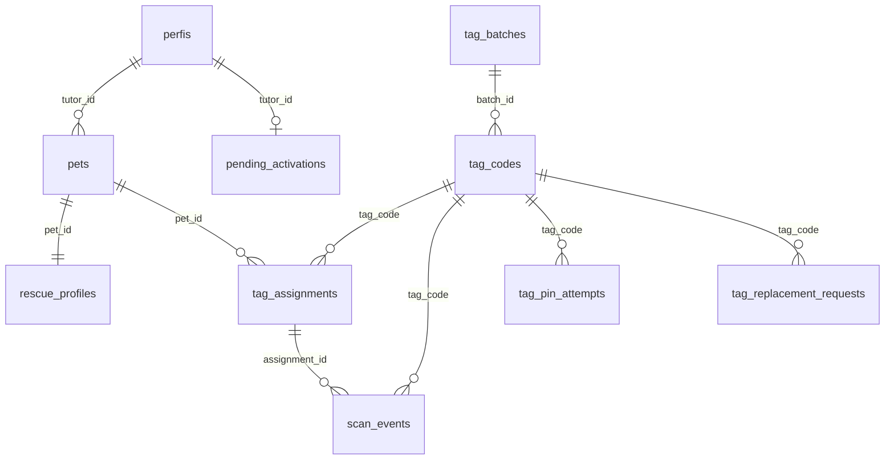
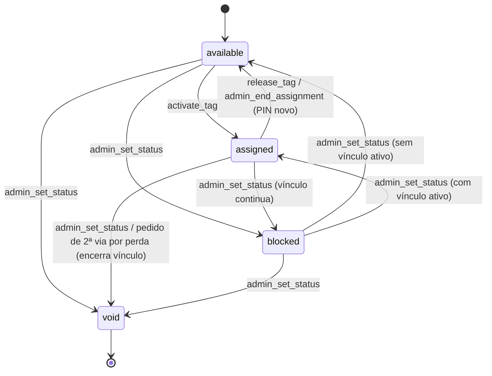

# Data Model: Tag com QR Code

Postgres (Supabase). Toda tabela nasce com RLS habilitada e sem política para `anon`, **na mesma
migration**. Nomes de tabelas novas em inglês (como no prompt do pivô); `perfis` e `is_admin()` já
existem (`001-login`) e são reaproveitados. Migrations desta spec: **0020 a 0034**.

## Diagrama

## Tabelas

### `pets` (0020)

| Coluna | Tipo | Regras |
|---|---|---|
| `id` | `uuid` PK | `default gen_random_uuid()` |
| `tutor_id` | `uuid` not null | FK `auth.users(id) on delete cascade` |
| `name` | `text` not null | 1 a 40 caracteres |
| `species` | `text` not null | `check (species in ('dog','cat'))` |
| `breed` | `text` | até 60 |
| `sex` | `text` | `check (sex in ('male','female'))`, pode ser nulo |
| `size` | `text` | `check (size in ('small','medium','large'))`, pode ser nulo |
| `neutered` | `boolean` | pode ser nulo |
| `birth_month` | `date` | primeiro dia do mês; pode ser nulo |
| `temperament` | `text[]` not null default `'{}'` | até 5 itens, cada um até 30 |
| `care_notes` | `text` | até 280 |
| `photo_path` | `text` | caminho no bucket `pet-photos`; pode ser nulo |
| `created_at`, `updated_at` | `timestamptz` | gatilho de `updated_at` |

Índice: `pets (tutor_id)`.

### `rescue_profiles` (0020, junto de `pets`)

Uma linha por pet, criada por gatilho ao inserir o pet.

| Coluna | Tipo | Padrão |
|---|---|---|
| `pet_id` | `uuid` PK, FK `pets(id) on delete cascade` | |
| `show_temperament` | `boolean` not null | `true` |
| `show_care` | `boolean` not null | `true` |
| `show_tutor_first_name` | `boolean` not null | `false` |
| `show_whatsapp` | `boolean` not null | `false` |
| `show_phone` | `boolean` not null | `false` |
| `lost_mode` | `boolean` not null | `false` |
| `lost_since` | `timestamptz` | nulo |
| `lost_message` | `text` | até 280 |
| `lost_show_since` | `boolean` not null | `true` |
| `lost_show_reward` | `boolean` not null | `false` |
| `lost_show_message` | `boolean` not null | `true` |
| `updated_at` | `timestamptz` | |

Regra em gatilho: `show_whatsapp` e `show_phone` só podem ser `true` se o celular do tutor estiver
confirmado (fato exposto por `004`: função `phone_is_confirmed(uuid)`).

### `tag_batches` (0021)

| Coluna | Tipo | Regras |
|---|---|---|
| `id` | `text` PK | ex.: `lote-001`; `check (id ~ '^lote-[0-9]{3,}$')` |
| `quantity` | `int` not null | 1 a 500 |
| `created_by` | `uuid` | FK `auth.users(id)` |
| `created_at` | `timestamptz` not null | `now()` |
| `notes` | `text` | |
| `package_downloaded_at` | `timestamptz` | nulo até o primeiro download |

### `tag_codes` (0021)

| Coluna | Tipo | Regras |
|---|---|---|
| `code` | `char(9)` PK | `check (code ~ '^[0-9A-HJKMNP-TV-Z]{9}$')` e `check (tag_is_valid(code))` |
| `batch_id` | `text` not null | FK `tag_batches(id)` |
| `status` | `text` not null default `'available'` | `check (status in ('available','assigned','blocked','void'))` |
| `activation_pin_hash` | `text` not null | bcrypt custo 12 |
| `pin_fail_count_24h` | `int` not null default 0 | |
| `pin_fail_window_start` | `timestamptz` | |
| `pin_locked_until` | `timestamptz` | |
| `qr_version` | `smallint` not null default 3 | |
| `qr_mask` | `smallint` not null | 0 a 7 |
| `notes` | `text` | |
| `created_at`, `updated_at` | `timestamptz` | |

Gatilhos: impedir `UPDATE` de `code`, `batch_id`, `qr_version` e `qr_mask`; impedir `DELETE`;
impedir sair de `void`.

Transições de `status`:

### `tag_assignments` (0022)

| Coluna | Tipo | Regras |
|---|---|---|
| `id` | `uuid` PK | |
| `tag_code` | `char(9)` not null | FK `tag_codes(code)` |
| `pet_id` | `uuid` | FK `pets(id) on delete set null` |
| `tutor_id` | `uuid` | FK `auth.users(id) on delete set null` |
| `started_at` | `timestamptz` not null | `now()` |
| `ended_at` | `timestamptz` | |
| `end_reason` | `text` | `check (end_reason in ('released','transferred','lost','damaged','admin','account_deleted'))` |

Índices únicos parciais: `(tag_code) where ended_at is null` e `(pet_id) where ended_at is null`.
Regra: `ended_at` e `end_reason` são nulos juntos ou preenchidos juntos.

> `pet_id` e `tutor_id` usam `set null` (e não `cascade`) para o histórico da tag sobreviver à
> exclusão do pet ou da conta. `account_deleted` é o motivo usado pela operação que `004` chama.

### `tag_pin_attempts` (0022)

| Coluna | Tipo |
|---|---|
| `tag_code` `char(9)`, `tutor_id` `uuid` | PK composta; `tutor_id` FK `auth.users(id) on delete cascade` |
| `fail_count` `int`, `window_start` `timestamptz`, `locked_until` `timestamptz` | |

### `pending_activations` (0023)

`tutor_id uuid PK` (FK `auth.users(id) on delete cascade`), `tag_code char(9) not null`, `created_at`, `expires_at` (`now() + 7 days`).
Sem FK para `tag_codes`: o código pode nem existir, e a tabela não pode servir de oráculo.

### `rate_limits` (0023, junto de `pending_activations`)

Contadores de janela fixa usados por `resolve_tag` (por `ip_hash`) e `check_tag_for_link` (por conta).

| Coluna | Tipo |
|---|---|
| `scope` | `text` not null — `resolve_ip_min`, `resolve_ip_hour`, `check_link_min` |
| `key` | `text` not null — `ip_hash` ou o id da conta |
| `window_start` | `timestamptz` not null — início da janela (truncado ao minuto ou à hora) |
| `count` | `int` not null default 1 |

PK `(scope, key, window_start)`. Incremento por `insert … on conflict do update`. RLS habilitada,
**sem nenhuma política**: só as funções `security definer` tocam a tabela. Linhas com mais de 48 h
são apagadas pelo job diário de `0033`.

### `scan_events` (0024)

| Coluna | Tipo | Regras |
|---|---|---|
| `id` | `uuid` PK | |
| `tag_code` | `char(9)` not null | FK `tag_codes(code)` |
| `assignment_id` | `uuid` | FK `tag_assignments(id)`; nulo quando a tag não estava vinculada |
| `status_at_scan` | `text` not null | situação da tag no momento |
| `occurred_at` | `timestamptz` not null | `now()` |
| `last_seen_at` | `timestamptz` not null | atualizado na deduplicação |
| `ip_hash` | `text` not null | HMAC; nunca o IP |
| `geo_method` | `text` not null | `check (geo_method in ('none','ip','gps'))` |
| `lat`, `lng` | `double precision` | |
| `accuracy_m` | `int` | margem em metros |
| `city`, `region` | `text` | da geolocalização por IP |
| `location_token_hash` | `text` | para a atualização com a localização precisa |
| `location_token_expires_at` | `timestamptz` | |
| `notified_at` | `timestamptz` | nulo enquanto o e-mail não saiu |
| `notify_attempts` | `smallint` not null default 0 | |

Índices: `(assignment_id, occurred_at desc)`, `(tag_code, ip_hash, last_seen_at desc)`,
`(notified_at) where notified_at is null`.

### `tag_replacement_requests` (0025)

`id uuid PK`, `tag_code`, `pet_id` (FK `pets(id) on delete set null`), `tutor_id` (FK `auth.users(id) on delete set null`), `kind check in ('damaged','lost')`,
`status check in ('open','done','cancelled') default 'open'`, `created_at`, `resolved_at`, `resolved_by`.

### `audit_log` (0026)

`id bigint identity PK`, `at timestamptz default now()`, `actor_id uuid`, `actor_role text`,
`event text not null`, `entity text`, `entity_id text`, `detail jsonb not null default '{}'`.
Só inserção, por função `audit(event, entity, entity_id, detail)` `security definer`. Sem `UPDATE`
nem `DELETE` para ninguém além do dono do banco. `detail` nunca contém PIN, telefone ou IP.

Eventos: `batch_created`, `batch_package_downloaded`, `pin_reissued`, `activation_failed`,
`activation_locked_account`, `activation_locked_tag`, `tag_activated`, `tag_released`,
`tag_status_changed`, `assignment_ended_by_admin`, `labels_reprinted`, `lost_mode_on`,
`lost_mode_off`, `replacement_requested`, `replacement_resolved`.

## Funções de apoio (0021 e 0027)

- Em `0021`, antes das tabelas (o `CHECK` de `tag_codes` depende delas):
  `tag_normalize(text) returns text`, `tag_is_valid(text) returns boolean` — `immutable` — e
  `tag_format(char(9)) returns text` — `XXXX-XXXX-X`.
- Em `0027`: as demais.
- `can_link_tag(uuid) returns boolean` — retorna `true`. `TODO(BILLING_MODEL)`.
- `new_activation_pin() returns text` — 6 caracteres Crockford com `gen_random_bytes`.
- `audit(...)`.

## RPCs (0028 a 0031 e 0034) e Storage (0032)

Assinaturas, erros e limites em `contracts/`. Resumo:

| RPC | Quem executa |
|---|---|
| `resolve_tag(p_code, p_ip_hash)` | só `service_role` (via Edge Function) |
| `register_scan(...)`, `set_scan_location(...)` | só `service_role` |
| `check_tag_for_link(p_code)` | `authenticated` |
| `activate_tag(p_code, p_pin, p_pet_id, p_replace boolean, p_enable_whatsapp boolean)` | `authenticated` |
| `release_tag(p_code, p_reason)` | `authenticated` |
| `request_tag_replacement(p_code, p_kind)` | `authenticated` |
| `set_lost_mode(p_pet_id, p_on, p_message, p_show_since, p_show_reward)` | `authenticated` |
| `set_pending_activation(p_code)`, `get_pending_activation()`, `clear_pending_activation()` | `authenticated` |
| `my_dashboard()` | `authenticated` |
| `end_assignments_for_account(p_tutor)`, `export_tutor_tag_data(p_tutor)` | só `service_role` (usadas por `004`; ficam em `0027`, ver `contracts/integration-002-004.contract.md` §4) |
| `admin_reissue_pin`, `admin_set_status`, `admin_end_assignment`, `admin_list_codes`, `admin_code_detail`, `admin_scan_queue`, `admin_audit` | `authenticated`, com `is_admin()` verificado dentro |
| `admin_insert_batch(...)` | só `service_role` (via `admin-create-batch`) |

Bucket `pet-photos` (0032): privado; políticas em `storage.objects` limitando leitura e escrita ao
prefixo `<auth.uid()>/`.

`0033`: job `pg_cron` de reenvio de avisos e limpeza de `pending_activations` vencidas.

## Matriz de RLS (resumo; detalhe em `contracts/rls-expectations.md`)

| Tabela | anon | tutor | admin |
|---|---|---|---|
| `pets` | — | CRUD nos seus | leitura |
| `rescue_profiles` | — | leitura e atualização dos seus (modo perdido só por RPC) | leitura |
| `tag_batches` | — | — | leitura |
| `tag_codes` | — | — (nunca direto; só por RPC) | leitura, **sem** a coluna do hash (por view ou RPC) |
| `tag_assignments` | — | leitura dos seus | leitura |
| `tag_pin_attempts` | — | — | leitura |
| `pending_activations` | — | só por RPC | — |
| `rate_limits` | — | — | — (só funções `security definer`) |
| `scan_events` | — | leitura dos scans dos seus vínculos, sem `ip_hash` nem token | leitura sem `ip_hash` |
| `tag_replacement_requests` | — | leitura dos seus; criação por RPC | leitura; resolução por RPC |
| `audit_log` | — | — | leitura por RPC |

Colunas sensíveis (`activation_pin_hash`, `ip_hash`, `location_token_hash`) não são concedidas a
`authenticated`: o acesso é por views ou RPCs que não as projetam.

## Dados de exemplo (`supabase/seed.sql`)

Tutora **Ana**, que no seed é o **tutor A** já existente (`tutor.a@faro.test`, criado pela `001` e
completado pela `004`; esta spec não cria nem altera usuários), pets **Paçoca** (cão, tag `7K3M-Q9XA-C` ativa desde 02 nov) e
**Mel** (gata, sem tag); lote `lote-teste` com 6 códigos em situações variadas
(`2FX8-CN73-F` disponível, `T6EV-BXPY-W` bloqueado, `PYC6-D7XD-3` anulado); 3 scans do Paçoca. Os
PINs do seed são conhecidos e servem só para desenvolvimento. **O seed nunca roda em produção.**
**Fonte única dos códigos de exemplo**: os códigos acima são ilustrativos. A tarefa de seed gera os
seis códigos com o módulo de código e grava o resultado em `e2e/fixtures/seed-codes.json`
(`{ assigned, available, blocked, void, … }`) e no trecho marcado de `seed.sql`
(`contracts/integration-002-004.contract.md` §6). Testes e2e e o `quickstart.md` leem
esse arquivo, nunca um código escrito à mão. Se, depois do teste cruzado, `7K3M-Q9XA-C` for válido
pela referência, ele passa a ser o código do Paçoca no seed.
