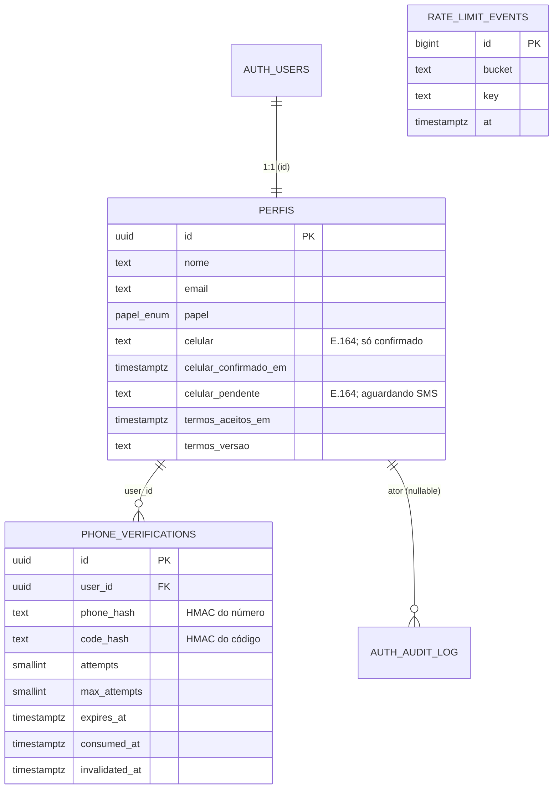
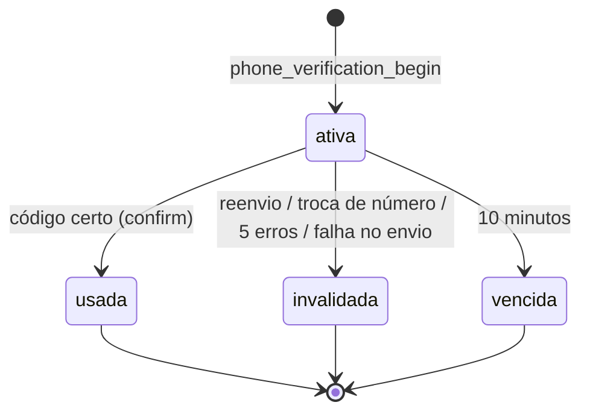

# Data Model — Conta do tutor (004-conta-tutor)

**Fase 1 do plano.** Usa os termos do glossário (`CLAUDE.md`) e da `001-login`: Conta/Usuário,
Papel, Sessão, Identidade Externa, Evento de Auditoria de Autenticação. **Nada da `001` é
redefinido**; `perfis` é estendida e `auth_audit_log` é reaproveitada.

Regras gerais:

- Toda tabela nova nasce com `ENABLE ROW LEVEL SECURITY` **na mesma migration**, sem política
  permissiva (negar por padrão), e com `REVOKE ALL … FROM anon, authenticated`.
- Toda função nova é `SECURITY DEFINER`, `SET search_path = public, pg_temp`, parâmetros tipados, **sem SQL
  dinâmico montado com entrada** e termina com `REVOKE ALL ON FUNCTION … FROM PUBLIC, anon,
  authenticated` seguido do `GRANT EXECUTE` específico da tabela "Quem executa".
- `perfis` continua em português (como na `001`); tabelas novas em inglês (como na `003`).
- Migrations desta spec: **0008 a 0019**. A `003` usa 0020 em diante.

## Alocação das migrations

| Nº | Arquivo | Conteúdo |
|---|---|---|
| 0008 | `0008_enum_eventos_conta.sql` | **Só** `ALTER TYPE evento_auth_enum ADD VALUE IF NOT EXISTS …` (12 valores). Nada mais: um valor novo de enum não pode ser usado na transação que o cria. |
| 0009 | `0009_hardening_funcoes_auth.sql` | `REVOKE EXECUTE` de `log_auth_event` e `record_login_attempt` para `PUBLIC`, `anon`, `authenticated`; `GRANT` a `service_role`. `REVOKE EXECUTE` de `is_admin` e `current_user_role` para `anon`. |
| 0010 | `0010_perfis_conta.sql` | Colunas novas em `perfis`, `CHECK`s, privilégios de coluna, gatilho de `updated_at`. |
| 0011 | `0011_rate_limit_events.sql` | Tabela `rate_limit_events` + RLS + função `rate_limit_check`. |
| 0012 | `0012_funcoes_conta.sql` | Substitui `handle_new_user`; cria `accept_terms`, `log_logout`, `my_account`, `account_auth_facts`. |
| 0013 | `0013_auditoria_auth_users.sql` | Função `audit_auth_user_changes` + gatilho `on_auth_user_updated`. |
| 0014 | `0014_phone_verifications.sql` | Tabela `phone_verifications` + RLS + índices. |
| 0015 | `0015_funcoes_celular.sql` | `phone_verification_begin`, `phone_verification_send_failed`, `phone_verification_active`, `phone_verification_confirm`, `phone_verification_status`, `phone_is_confirmed`. |
| 0016 | `0016_conta_privacidade.sql` | `export_my_data`, `delete_account_data`. |
| 0017–0019 | — | **Reservadas** para correções desta spec. Não usar para outra coisa. |

---

## ER (recorte)



`AUTH_USERS`, `auth.identities` e `auth.sessions` são nativos do Supabase Auth e não são alterados
(apenas ganham um gatilho `AFTER UPDATE` de auditoria em `auth.users`).

---

## 1. `public.perfis` (existente, estendida em 0010)

### Colunas novas

| Coluna | Tipo | Regras |
|---|---|---|
| `celular` | `text` nulo | E.164. **Só recebe número confirmado.** `CHECK (celular ~ '^\+55[1-9][0-9]9[0-9]{8}$')` |
| `celular_confirmado_em` | `timestamptz` nulo | Data da confirmação do número em `celular` |
| `celular_pendente` | `text` nulo | Número informado e ainda não confirmado (cadastro ou troca). Mesmo `CHECK` de formato |
| `termos_aceitos_em` | `timestamptz` nulo | Data e hora do aceite |
| `termos_versao` | `text` nulo | Versão aceita, formato `AAAA-MM`. `CHECK (termos_versao ~ '^[0-9]{4}-[0-9]{2}$')` |

### Restrições novas

| Nome | Regra |
|---|---|
| `perfis_celular_confirmado_coerente` | `(celular IS NULL) = (celular_confirmado_em IS NULL)` |
| `perfis_termos_coerente` | `(termos_aceitos_em IS NULL) = (termos_versao IS NULL)` |
| `perfis_nome_tamanho` | `char_length(nome) <= 80` |

> O mínimo de 2 caracteres do nome é validado no cliente e em `handle_new_user`/atualização pelo
> app; o banco não o impõe porque há linhas antigas com nome vazio.

### Invariantes

1. **`perfis.celular IS NOT NULL` ⇔ o celular da conta está confirmado.** É a coluna que a `003`
   lê em `resolve_tag`. `celular_pendente` **nunca** é exposto fora da própria conta.
2. Na troca de número, `celular` (antigo) permanece até `phone_verification_confirm` promover
   `celular_pendente`. Não existe estado "sem número" no meio da troca.
3. `papel` continua imutável pelo próprio usuário (política da `001`).

### Privilégios (0010)

```sql
REVOKE ALL ON public.perfis FROM anon;
REVOKE INSERT, UPDATE, DELETE, TRUNCATE, REFERENCES, TRIGGER ON public.perfis FROM authenticated;
GRANT SELECT ON public.perfis TO authenticated;
GRANT UPDATE (nome) ON public.perfis TO authenticated;
```

As políticas da `001` (`perfis_self_select`, `perfis_self_update`, `perfis_admin_all`) **não são
alteradas**. O privilégio de coluna é conferido antes da RLS: mesmo o próprio dono só altera `nome`.

### Gatilho

`perfis_set_updated_at` (`BEFORE UPDATE`): `NEW.updated_at := now()`.

---

## 2. `public.phone_verifications` (0014)

Uma linha por código emitido. No máximo **uma ativa por conta**.

| Coluna | Tipo | Regras |
|---|---|---|
| `id` | `uuid` PK | `DEFAULT gen_random_uuid()` |
| `user_id` | `uuid` NOT NULL | FK `public.perfis(id) ON DELETE CASCADE` |
| `phone_hash` | `text` NOT NULL | `HMAC-SHA256(PHONE_OTP_PEPPER, 'phone|' || e164)` em hexadecimal. Nunca o número |
| `code_hash` | `text` NOT NULL | `HMAC-SHA256(PHONE_OTP_PEPPER, 'code|' || user_id || '|' || e164 || '|' || code)` em hexadecimal |
| `attempts` | `smallint` NOT NULL | `DEFAULT 0`, `CHECK (attempts >= 0)` |
| `max_attempts` | `smallint` NOT NULL | `DEFAULT 5` |
| `expires_at` | `timestamptz` NOT NULL | `now() + 10 min` |
| `consumed_at` | `timestamptz` nulo | preenchido no acerto |
| `invalidated_at` | `timestamptz` nulo | preenchido por reenvio, troca de número, 5 erros ou falha de envio |
| `created_at` | `timestamptz` NOT NULL | `DEFAULT now()` |

Índices:

- `UNIQUE (user_id) WHERE consumed_at IS NULL AND invalidated_at IS NULL` (uma ativa por conta).
- `(user_id, created_at DESC)`.

"Ativa" = `consumed_at IS NULL AND invalidated_at IS NULL AND expires_at > now() AND attempts < max_attempts`.



O número pendente em claro fica em `perfis.celular_pendente` (dado da própria conta); aqui só há
hashes com chave. O código nunca é gravado, registrado em log nem devolvido.

**Limpeza**: `phone_verification_begin` apaga as linhas da conta com mais de 24 horas.

RLS: habilitada, **sem política**. Só `service_role` e as funções `security definer`.

---

## 3. `public.rate_limit_events` (0011)

Contador genérico de janela deslizante para os limites desta spec. Não substitui
`auth_login_attempts` (limite de login da `001`, que continua como está).

| Coluna | Tipo | Regras |
|---|---|---|
| `id` | `bigint` PK | `GENERATED ALWAYS AS IDENTITY` |
| `bucket` | `text` NOT NULL | nome do limite (tabela abaixo) |
| `key` | `text` NOT NULL | id da conta, hash do número, hash do IP, hash do e-mail ou `'global'`. **Nunca** e-mail, telefone ou IP em claro |
| `at` | `timestamptz` NOT NULL | `DEFAULT now()` |

Índice: `(bucket, key, at DESC)`. RLS habilitada, sem política.

### Limites

| `bucket` | `key` | Máximo | Janela (s) | Usado por |
|---|---|---|---|---|
| `sms:cooldown` | `user_id` | 1 | 60 | `phone-verify-start` |
| `sms:account:h` | `user_id` | 5 | 3600 | `phone-verify-start` |
| `sms:account:d` | `user_id` | 10 | 86400 | `phone-verify-start` |
| `sms:phone:d` | `phone_hash` | 5 | 86400 | `phone-verify-start` |
| `sms:ip:h` | `ip_hash` | 30 | 3600 | `phone-verify-start` |
| `sms:global:d` | `'global'` | `SMS_DAILY_CAP` (500) | 86400 | `phone-verify-start` |
| `recovery:identity:h` | hash do e-mail | 3 | 3600 | `password-recovery` |
| `recovery:ip:h` | `ip_hash` | 10 | 3600 | `password-recovery` |
| `reauth:account` | `user_id` | 5 | 900 | `_shared/reauth.ts` (só falhas) |
| `export:account:d` | `user_id` | 3 | 86400 | `export_my_data` |
| `logout:account:h` | `user_id` | 20 | 3600 | `log_logout` |

**Limpeza**: `rate_limit_check` apaga, para cada par `(bucket, key)` consultado, as linhas com mais
de 48 horas.

---

## 4. `public.auth_audit_log` (existente) — eventos novos (0008)

A tabela, as políticas e `log_auth_event` da `001` não mudam. `evento_auth_enum` ganha:

| Evento | Quem grava | `ator` | `detalhe` (mínimo, sem dado pessoal) |
|---|---|---|---|
| `conta_criada` | gatilho `handle_new_user` | id | `{"metodo":"email"\|"google"}` |
| `email_confirmado` | gatilho em `auth.users` | id | `{}` |
| `termos_aceitos` | `handle_new_user` e `accept_terms` | id | `{"versao":"2026-11"}` |
| `celular_codigo_enviado` | `phone-verify-start` | id | `{"troca":true\|false}` |
| `celular_codigo_invalido` | `phone_verification_confirm` | id | `{"restantes":n}` |
| `celular_bloqueado` | `phone-verify-start` / `phone_verification_confirm` | id | `{"motivo":"limite_envio"\|"tentativas","bucket":"…"}` |
| `celular_confirmado` | `phone_verification_confirm` | id | `{"troca":true\|false}` |
| `senha_recuperacao_solicitada` | `password-recovery` (pedido) e gatilho (envio) | nulo / id | `{"origem":"pedido","permitido":true\|false}` / `{"origem":"envio"}` |
| `senha_alterada` | gatilho em `auth.users` | id | `{"apos_recuperacao":true\|false}` |
| `reautenticacao_falha` | `_shared/reauth.ts` | id | `{"acao":"trocar_celular"\|"excluir_conta"}` |
| `dados_exportados` | `export_my_data` | id | `{}` |
| `conta_excluida` | `delete_account_data` | id (vira nulo no `CASCADE`) | `{"vinculos_encerrados":n}` |
| `logout` (já existe) | `log_logout` | id | `{}` |

Proibido em `detalhe`: e-mail, telefone (inteiro ou parcial), código, link, senha, IP.
Eventos gravados por gatilho têm `ip_hash = ''` e `user_agent = ''`.

Na exclusão da conta, `auth_audit_log.ator` passa a `NULL` (`ON DELETE SET NULL` da `001`): os
eventos ficam, a pessoa some.

---

## 5. Funções

### Quem executa

| Função | `anon` | `authenticated` | `service_role` | Migration |
|---|---|---|---|---|
| `rate_limit_check(jsonb, boolean)` | não | não | sim | 0011 |
| `phone_verification_begin(uuid, text, text, text, integer, integer)` | não | não | sim | 0015 |
| `phone_verification_send_failed(uuid)` | não | não | sim | 0015 |
| `phone_verification_active(uuid)` | não | não | sim | 0015 |
| `phone_verification_confirm(uuid, uuid, text, text, text)` | não | não | sim | 0015 |
| `phone_verification_status()` | não | sim (própria conta) | sim | 0015 |
| `phone_is_confirmed(uuid)` | não | sim (ver regra) | sim | 0015 |
| `handle_new_user()` | — (gatilho) | — | — | 0012 |
| `accept_terms(text)` | não | sim | não | 0012 |
| `log_logout()` | não | sim | não | 0012 |
| `my_account()` | não | sim | não | 0012 |
| `account_auth_facts(uuid)` | não | não | sim | 0012 |
| `audit_auth_user_changes()` | — (gatilho) | — | — | 0013 |
| `export_my_data()` | não | sim | não | 0016 |
| `delete_account_data(uuid, text, text)` | não | não | sim | 0016 |
| `log_auth_event(…)` (da `001`) | **não** (corrigido) | **não** (corrigido) | sim | 0009 |
| `record_login_attempt(…)` (da `001`) | **não** (corrigido) | **não** (corrigido) | sim | 0009 |

Assinaturas, entradas, saídas e erros de cada uma estão em `contracts/`.

### `phone_is_confirmed(p_user_id uuid) returns boolean` — o fato único

```sql
SELECT CASE
  WHEN p_user_id IS NULL THEN false
  WHEN coalesce(auth.role(), '') = 'authenticated'
       AND p_user_id IS DISTINCT FROM auth.uid()
       AND NOT public.is_admin() THEN false
  ELSE EXISTS (SELECT 1 FROM public.perfis
               WHERE id = p_user_id AND celular IS NOT NULL AND celular_confirmado_em IS NOT NULL)
END;
```

Um tutor só obtém resposta sobre a **própria** conta; chamadas com `service_role`, gatilhos e
funções `security definer` da `003` obtêm para qualquer conta.

---

## 6. Dados fora do banco

| Dado | Onde | Observação |
|---|---|---|
| Senha | `auth.users.encrypted_password` (Supabase Auth) | nunca lida por nós; `account_auth_facts` só informa se existe |
| Sessões | `auth.sessions` | encerradas por `signOut` (`others`/`global`) e por `deleteUser` |
| Identidade Google | `auth.identities` | `my_account()` devolve a lista de provedores |
| Metadados do cadastro | `auth.users.raw_user_meta_data` | `name`, `phone` (removido no 1º envio de SMS), `terms_version`, `return_to`, `return_to_at` (removidos após o uso). **Graváveis pelo usuário: nunca autorizam nada** |
| Destino de retorno | `sessionStorage` (`faro.returnUrl`) e metadados | sempre sanitizado |
| Marca "já entrou neste aparelho" | `localStorage` (`faro.returning`) | não sensível |
| Preferência de aparência | mecanismo da `002` | por aparelho |
| Chave dos códigos | `PHONE_OTP_PEPPER` (segredo de Edge Function) | nunca no banco, nunca no cliente |

---

## 7. Matriz de RLS e privilégios

| Objeto / operação | `anon` | tutor (própria) | tutor (outra conta) | admin (`is_admin()`) | `service_role` |
|---|---|---|---|---|---|
| `perfis` SELECT | nega | lê | **nega** | lê todas | total |
| `perfis` UPDATE `nome` | nega | altera | **nega** | altera | total |
| `perfis` UPDATE `celular`, `celular_confirmado_em`, `celular_pendente`, `termos_*`, `email`, `papel`, `id` | nega | **nega** | **nega** | **nega** (só por SQL de manutenção) | total |
| `perfis` INSERT / DELETE | nega | nega | nega | nega | total (gatilho / cascata) |
| `phone_verifications` (tudo) | nega | nega | nega | nega | total |
| `rate_limit_events` (tudo) | nega | nega | nega | nega | total |
| `auth_audit_log` SELECT | nega | nega (só os próprios eventos, por `export_my_data`) | nega | lê | total |
| `auth_audit_log` INSERT | nega | nega | nega | nega | por `log_auth_event` |
| `auth.users` e demais do Auth | nega | geridas pelo Auth | nega | nega | Auth / API de admin |

Cada "nega" é um teste negativo obrigatório em pgTAP (`contracts/rls-expectations.md`).

---

## 8. Validações cliente ↔ banco

| Campo | Cliente (UX) | Servidor (verdade) |
|---|---|---|
| nome | 2 a 80 caracteres | `CHECK` ≤ 80; `handle_new_user` corta em 80 |
| e-mail | formato | Supabase Auth |
| senha | 8 a 72 | `minimum_password_length = 8` no Auth |
| celular | máscara `(11) 98765-4321`; normaliza para E.164 | regex na Edge Function + `CHECK` em `perfis` |
| aceite | caixa marcada | `termos_aceitos_em`/`termos_versao` gravados só por função |
| código SMS | 6 dígitos | HMAC conferido em `phone_verification_confirm` |
| destino de retorno | `sanitizeReturnUrl` | não se aplica: nunca usado para autorizar |
